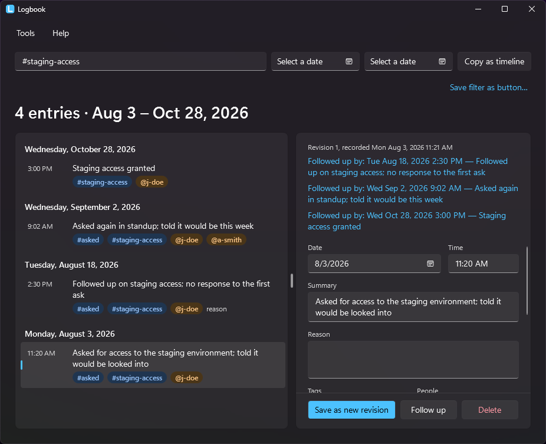
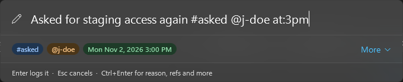
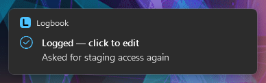
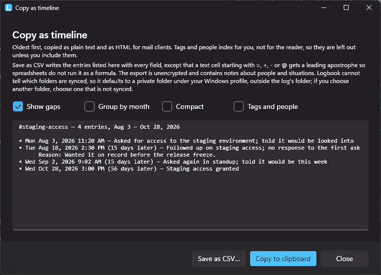

# Logbook

Logbook is a personal Windows tray app for writing down decisions and events as they happen. Press a hotkey, type one line, press Enter. Later, ask it "when did that happen, how many times, and did I tell anyone" and paste the answer as a dated timeline.

Everything lives in one encrypted, append-only file in a folder you choose.



## How it works

### 1. Capture

Press `Ctrl+Alt+L` anywhere. A launcher-style box appears. Type one line and press Enter.



`#tags`, `@people` and `at:` are picked out as you type and shown as chips, so you see what will be stored before you commit it. The rest of the line is the summary. `Ctrl+Enter` opens a "more" section for a reason, extra tags and people, and refs such as ticket numbers.

A toast confirms the write. Click it to open the entry and fix a typo; there is no separate undo.



### 2. Find

Open the main window from the tray icon, from the toast, or with `Ctrl+Alt+Shift+L`. The filter box uses the same grammar as capture, so `#asked @j-doe last:30d "release freeze"` works the way you would expect. Results are grouped by day, newest first, and the header always shows the count and the date range. A filter you keep typing can be saved as a button.

Selecting an entry opens it for editing. Every save is a new revision, and the pane shows the full history with changed fields highlighted. "Follow up" starts a new entry linked to the selected one, and the original lists its follow-ups. A reminder on an entry shows as a tray balloon when it is due.

### 3. Share

"Copy as timeline" turns the filtered set into a plain-text timeline, oldest first, with optional gaps between entries and month counts. It goes on the clipboard as text and as HTML, so it pastes cleanly into mail and chat.



```
#staging-access — 4 entries, Aug 3 – Oct 28, 2026

• Mon Aug 3, 2026 11:20 AM — Asked for access to the staging environment; told it would be looked into
• Tue Aug 18, 2026 2:30 PM (15 days later) — Followed up on staging access; no response to the first ask
      Reason: Wanted it on record before the release freeze.
• Wed Sep 2, 2026 9:02 AM (15 days later) — Asked again in standup; told it would be this week
• Wed Oct 28, 2026 3:00 PM (56 days later) — Staging access granted
```

The same set can be saved as CSV for a spreadsheet, and Tools → Export decrypted writes the whole log as plaintext JSONL.

## The grammar

One grammar serves both capture and search.

| Token | Example | In capture | In search |
|---|---|---|---|
| `#tag` | `#asked` | attaches the tag | entries with that tag |
| `@person` | `@j-doe` | attaches the person | entries involving that person |
| `at:` | `at:yesterday,3pm`, `at:2026-10-06`, `at:mon` | sets when it happened | |
| `since:` / `until:` | `since:2026-10-01` | | inclusive date bounds |
| `last:` | `last:30d`, `last:12w`, `last:6m` | | the last N days, weeks or months |
| `"phrase"` | `"release freeze"` | | exact phrase in the summary or reason |
| anything else | `told the team` | the summary | words that must all appear |

Some lines and what they store:

| You type | Summary | Tags | People | When |
|---|---|---|---|---|
| `Told the team the migration moves to the 16th #told @j-doe @r-lee` | Told the team the migration moves to the 16th | told | j-doe, r-lee | now |
| `Printer outage reported to facilities #reported #printer at:yesterday` | Printer outage reported to facilities | reported, printer | | yesterday at noon |
| `Decided to keep the nightly job as is #decided at:mon` | Decided to keep the nightly job as is | decided | | last Monday at noon |

A `#` or `@` starts a token only at the start of a word and before a letter, so `ticket #12345`, `C#` and `name@example.com` stay plain text. Put the verb in a tag (`#asked`, `#told`, `#decided`) and "did I tell anyone about X" becomes the search `#told X`. The full rules are in [docs/grammar.md](docs/grammar.md), and Help → Grammar cheat sheet shows them in the app.

## Get it

- Download `Logbook.exe` from the [Releases](https://github.com/malvinly/logbook/releases) page, drop it in a folder and run it. It is one self-contained file; nothing is installed.
- Windows SmartScreen warns the first time you run a downloaded copy, because the exe is not code-signed. Each release lists the SHA-256 of its exe; check it, then choose "More info" and "Run anyway".
- The first run asks where the data file should live, sets a passphrase and offers to start with Windows.
- There is no passphrase recovery. Write it down somewhere physical.
- Built and tested on Windows 11. Windows 10 should work but is untested.

## How it keeps your data

- One file, `logbook.jsonl`, in a folder you choose. Put it somewhere a sync service backs up; the format is built to survive living in a sync folder.
- Each entry is a line encrypted with AES-256-GCM under a data key that your passphrase unwraps. Changing the passphrase rewrites only the header.
- The file is only ever appended to. Edits and deletes are new lines, so the history is complete.
- The app starts locked. It locks again after an hour without input, when Windows locks or signs out, or on "Lock now" in the tray menu.
- Timestamps keep the UTC offset they were captured with. Nothing is converted to UTC or to the current machine zone.
- Plaintext exports default to a private folder under your Windows profile, outside the log's folder.
- The look is Windows 11 Fluent, following the Windows light or dark mode or forced from Settings. The screenshots above are the dark theme.

## Build it

```
dotnet build
dotnet test
dotnet publish src/Logbook.App -c Release -r win-x64 --self-contained -p:PublishSingleFile=true -p:PublishTrimmed=false
```

The version is shown at the foot of the Settings window.

## Where things are

- [docs/](docs/) is the spec: [grammar](docs/grammar.md), [record schema and file format](docs/file-format.md), [locking](docs/locking.md), [main window](docs/main-window.md), [export](docs/export.md), [settings](docs/settings.md) and [development notes](docs/development.md) on layout, decisions, build and release.
- [TODO.md](TODO.md) is the roadmap: what is left before 1.0, the backlog, and what is out of scope.
- [CLAUDE.md](CLAUDE.md) holds the conventions for working in this repo.
- `src/Logbook.Core` is the UI-free library (model, parser, crypto, file store, query, export); `src/Logbook.App` is the WPF tray app; `tests/Logbook.Tests` holds the Core tests.

## License

MIT, see [LICENSE](LICENSE).
